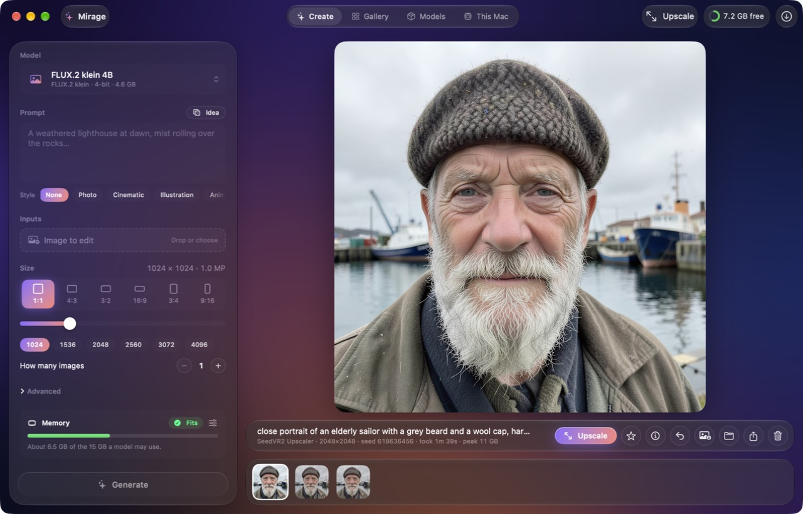
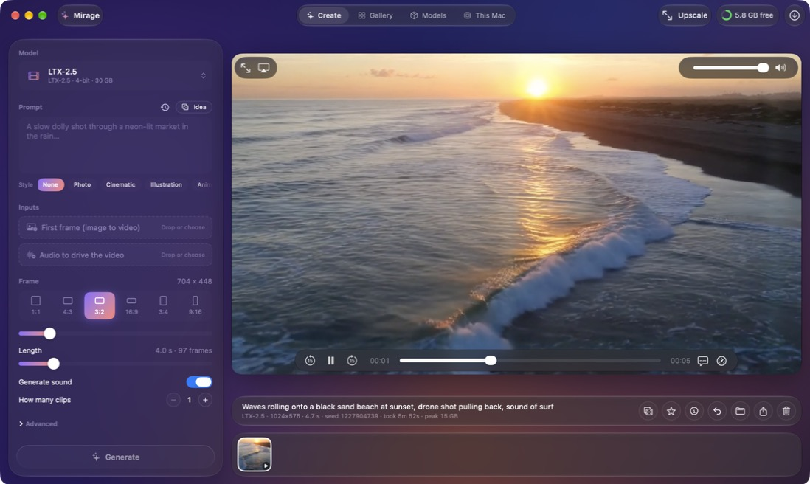
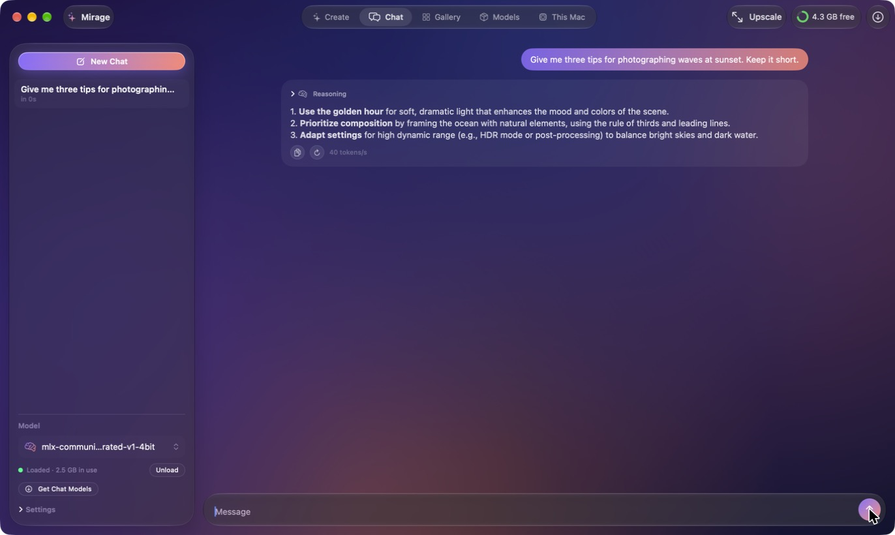
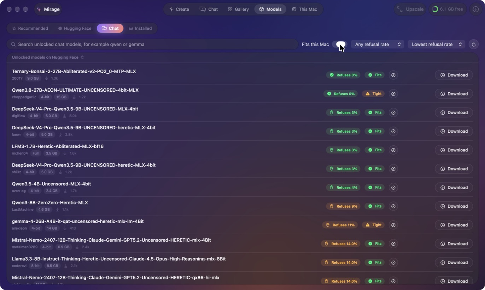

# Mirage

A native macOS app for running AI models on your own Mac with MLX: image generation and editing, video with sound, upscaling, and chat. Nothing is sent to a server. Models download once from Hugging Face and run on the Apple Silicon GPU.

**[Download the latest release](https://github.com/SkeletonDoctor/Mirage/releases/latest)**



## Features

### Images

- Text to image, image to image and instruction-based editing with FLUX, Z-Image, Qwen Image, Krea and other models supported by [mflux](https://github.com/filipstrand/mflux).
- Sizes up to 4096 px, six aspect ratios, style presets, and up to eight images per run, each with its own seed.
- Sample prompts, prompt history, and a time estimate based on your own past runs.

### Video

- LTX-2.3 and LTX-2.5 with synchronised sound through [ltx-2-mlx](https://github.com/dgrauet/ltx-2-mlx), from text, a first-frame image or an audio track.
- Wan 2.x through [mlx-video](https://github.com/Blaizzy/mlx-video).



### Upscaling

- Enlarge any image, generated or imported, up to 4× with the optional SeedVR2 upscaler.
- Adjustable scale, softness, weight precision and decode tile size, with the memory cost shown before you start.

### Chat

- A Chat tab for local language models through mlx-lm, with saved conversations, streamed replies you can stop, copy or retry, and the model's reasoning shown separately when it has one.
- It lists only unlocked models: those labelled abliterated, uncensored or similar on Hugging Face.
- **Models → Chat** shows the refusal rate each model's author states on its card, sorts lowest first, and filters by a maximum rate and by what fits your Mac. These figures are the authors' own measurements; Mirage reads them but does not test them, and many cards give none.





### Models and downloads

- Recommended models with the variant that suits your Mac picked for you (4-bit on small Macs, full precision on large ones).
- A live Hugging Face browser for MLX image and video models, with per-file selection.
- Fast downloads: large files are fetched in parallel parts, resume where they stopped, and are checked against Hugging Face's checksum.
- Choose where models, images and videos are stored; existing models can be moved for you.

### Memory

- Reads the machine's memory, switches on low-memory modes and tiled decoding automatically, and shows what each generation will need before it starts.
- Every limit can be raised by hand.
- Frees what it can on its own: a chat model unloads when idle or when a generation starts, and each engine exits when its job is done.

### Interface

- Liquid Glass design with a top toolbar and custom controls.
- Queue with visible waiting jobs, gallery with search and favourites, full-window image viewer, and an info panel with every setting used.
- Light on resources: close to 0% CPU while idle in the background.

## Install

Download the latest `Mirage-x.y.dmg` from [Releases](https://github.com/SkeletonDoctor/Mirage/releases), open it and drag Mirage to Applications.

The app is not notarized by Apple, so the first time you open it macOS will refuse. To allow it:

1. Try to open Mirage once and dismiss the warning.
2. Open **System Settings → Privacy & Security**, scroll to the Security section and click **Open Anyway** next to Mirage.
3. Confirm with your password or Touch ID. After that it opens normally.

## Requirements

- Apple Silicon Mac
- macOS 26 or later
- Xcode 26 or later (Swift 6.2), only if you build it yourself

## Build

```bash
Scripts/build.sh --install
```

This builds `build/Mirage.app`, copies it to `/Applications` and opens it. Use `Scripts/build.sh --open` to run it without installing, or `Scripts/make_dmg.sh` to package a DMG.

## How it works

Mirage is a SwiftUI front end. The model work is done by four Python engines, each installed on demand into its own private environment under `~/Library/Application Support/Mirage/engines` using [uv](https://github.com/astral-sh/uv) (downloaded automatically if it is missing). Models are kept in the standard Hugging Face cache unless you choose another folder.

| Engine | Used for |
|---|---|
| `mflux` | image generation, editing and upscaling |
| `ltx-2-mlx` | LTX video with sound |
| `mlx-video` | Wan video |
| `mlx-lm` | chat |

## Headless checks

The binary has test commands that exercise the core without the window:

```bash
swift build
.build/debug/Mirage --selftest system
.build/debug/Mirage --selftest search "flux"
.build/debug/Mirage --selftest download mflux-community/flux2-klein-4b-mflux-q4
.build/debug/Mirage --selftest generate mflux-community/flux2-klein-4b-mflux-q4 "a red fox in snow" 768 768
.build/debug/Mirage --selftest refusals
```

## Status

Developed and tested on an M5 with 16 GB. Run end to end so far:

- image generation and editing, up to 2048 px
- 2× upscaling
- LTX-2.5 video with sound (1024 × 576, 4.7 s, about six minutes)
- chat with a 4-bit 4B model (about 40 tokens a second)

Not yet run end to end: Wan video, and 3× or 4× upscaling.

## Licence

Mirage's own code is released under the [MIT licence](LICENSE).

Models and engines belong to their authors and carry their own licences; check each model's page before commercial use.
